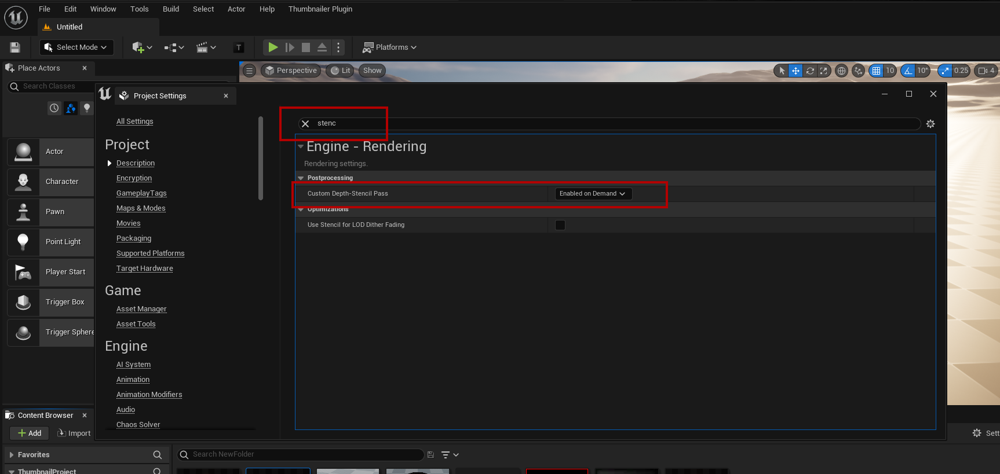
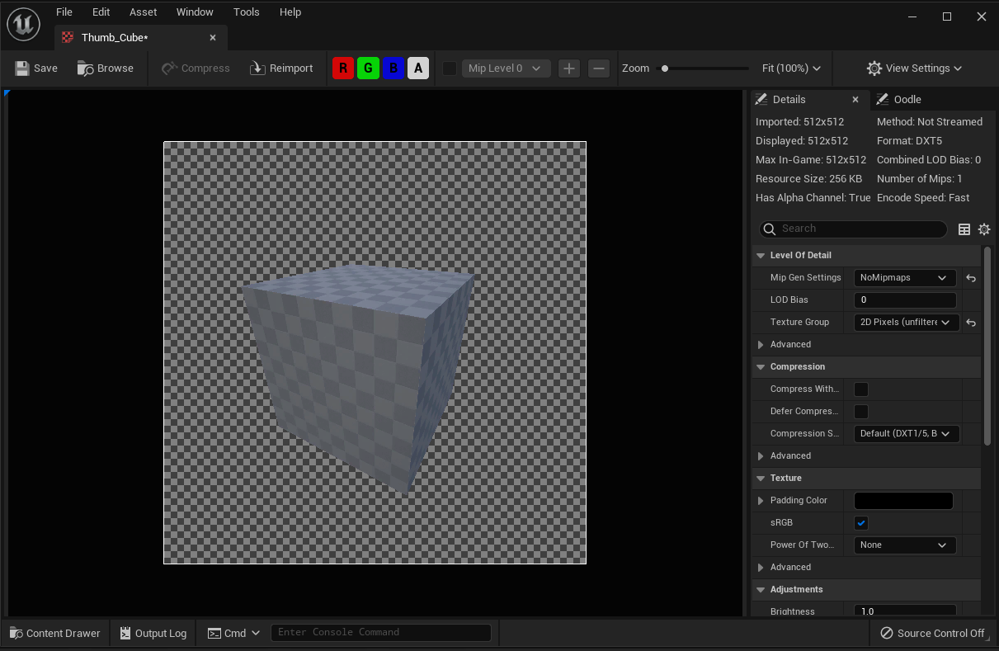
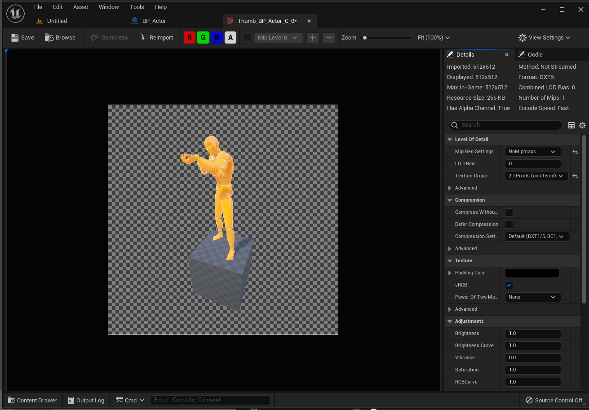
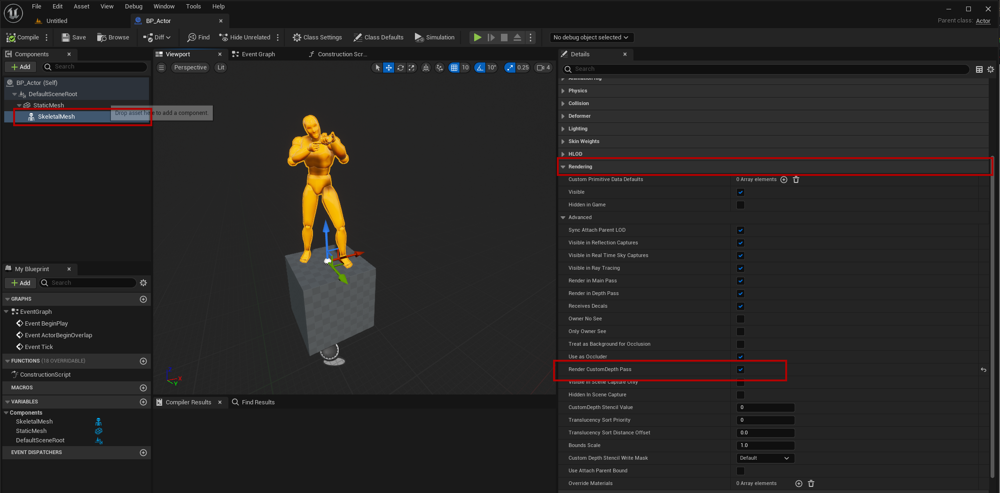

# Transparent Thumbnails

A transparent thumbnail only contains the asset. The background, the floor and the sky are removed, so the thumbnail can be placed on any UI.

## Custom Depth-Stencil Pass
Transparent thumbnails use the custom depth pass to find the asset. It is enabled by default in Unreal Engine. If **Custom Depth-Stencil Pass** is set to **Disabled** in **Edit → Project Settings → Engine → Rendering**, the plugin enables it when you capture. It stays enabled until the editor is closed, and the project settings are not changed.

:::note Versions before 2.0.2
Earlier versions don't enable it. Open **Edit → Project Settings → Engine → Rendering** and set **Custom Depth-Stencil Pass** to **Enabled on Demand**, or **Enabled with Stencil**.

:::

## Turn on Transparent
- Check **Transparent** under **Output** in the right panel. It is the same setting as **Transparent Thumbnail** under **Settings → Output**.
- The **Transparent** badge is shown in the upper left corner of the preview.

The preview still shows the background. It is removed when you capture.

## The result
The thumbnail is imported as a texture with an alpha channel.

## Actors
Actor Blueprints are set up by the plugin too. When the actor is spawned in the preview, **Render CustomDepth Pass** is turned on for every visible component, also on child actors. Only the actor in the preview is changed, the Blueprint is not.

These components are not included and are removed together with the background:
- Editor-only components, for example billboards and arrows.
- Components with **Hidden in Game** turned on, or that are not visible.
- Components that are added after the actor is spawned, for example in **BeginPlay**. Components added in the **Construction Script** are included.

To leave a component out of the thumbnail, turn on **Rendering → Hidden in Game** on it in the actor Blueprint.

:::note Versions before 2.0.2
Actors are set up by the plugin from version 2.0.2. In earlier versions, every component that should be visible in the thumbnail must have **Render CustomDepth Pass** turned on. Components without it are removed together with the background.

Open the actor Blueprint, select each mesh component and turn on **Rendering → Render CustomDepth Pass**.

:::

## Nanite
Transparent thumbnails don't work with Nanite meshes. A red warning is shown below the preview when the selected static mesh has Nanite turned on.

- Open the static mesh and turn off **Nanite Support**, or capture it without a transparent background.

## HDR
Transparent backgrounds don't work when the editor renders in HDR, for example when HDR display output is turned on. The **HDR** badge is shown in the upper right corner of the preview when this is the case. Turn off HDR display output to capture transparent thumbnails.
